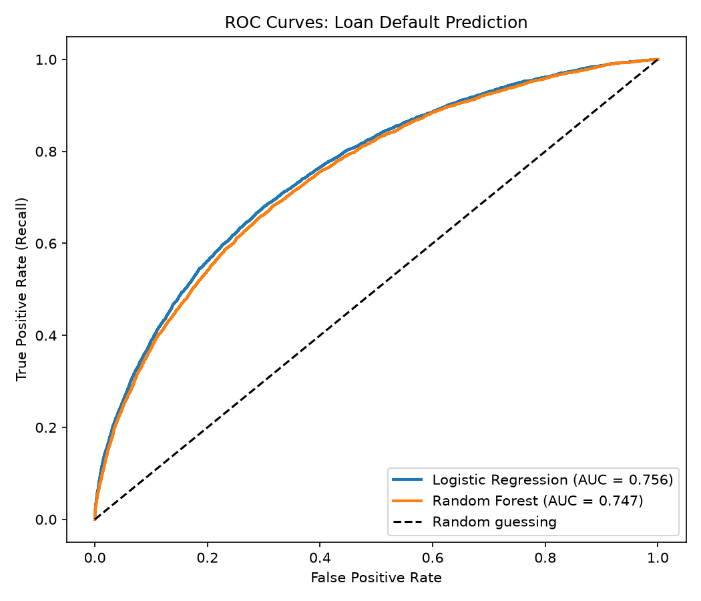
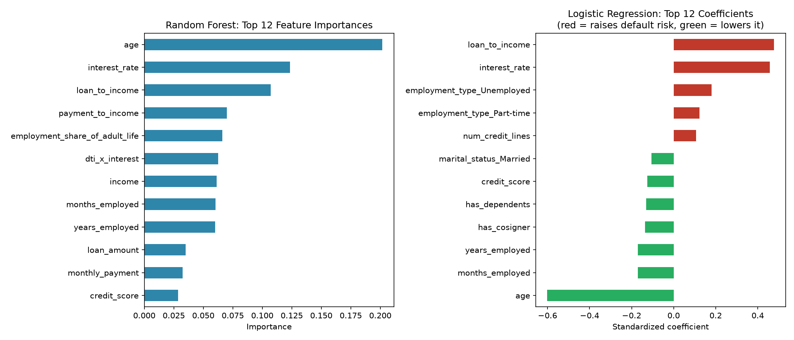

# Credit Risk / Loan Default Prediction

An end-to-end data science project that stores loan data in **MySQL**, explores default risk with **SQL**, and predicts which borrowers are likely to default using **Python and machine learning**.

## Project Goal
Lenders lose money when borrowers default, but rejecting too many good borrowers also costs revenue. This project builds a model that scores default risk, and compares an interpretable model (Logistic Regression) against a more flexible one (Random Forest).

## Dataset
[Loan Default Prediction Dataset (Kaggle)](https://www.kaggle.com/datasets/nikhil1e9/loan-default) — 255,347 loans, 18 columns (income, credit score, loan amount, DTI ratio, employment, and more). Download it and save it as `data/loan_data.csv`.

## Pipeline
```
loan_data.csv -> MySQL (database.py) -> cleaning (data_cleaning.py)
              -> features (feature_engineering.py) -> models (model_training.py)
                         \-> SQL insights (analysis.sql + run_sql_analysis.py)
```

1. **`database.py`** creates the MySQL database and loads the CSV in batches
2. **`data_cleaning.py`** pulls data with SQL, removes duplicates and impossible values
3. **`feature_engineering.py`** builds affordability features (loan-to-income, estimated monthly payment, payment-to-income, employment stability)
4. **`model_training.py`** trains and compares Logistic Regression and Random Forest
5. **`analysis.sql` / `run_sql_analysis.py`** answer business questions in SQL (default rate by credit band, income, DTI, loan purpose, and more)

## Methodology
- **Class imbalance:** only a minority of loans default, so a model that predicts "no default" for everyone scores high accuracy while being useless. Both models use class weights, and evaluation focuses on **ROC-AUC, precision, and recall**.
- **Stratified train/test split** (80/20) keeps the default rate consistent.
- **3-fold cross-validation** on the training set checks model stability.
- **Threshold analysis** shows the precision/recall trade-off, since the right cutoff depends on the cost of a missed default vs. a rejected good borrower.

## Results


| Model | ROC-AUC | Precision | Recall | F1 |
|---|---|---|---|---|
| Logistic Regression | 0.756 | 0.225 | 0.689 | 0.340 |
| Random Forest | 0.747 | 0.242 | 0.611 | 0.346 |

**Key findings:** 
- Logistic Regression edged out Random Forest on ROC-AUC (0.756 vs 0.747), and 3-fold cross-validation agreed (0.757 vs 0.746, standard deviation ≤ 0.002), so the simpler, interpretable model matched the more complex one. 
- Moving the decision threshold changes the trade-off sharply. At 0.3 the model catches 91% of defaults but flags 68% of all loans. At 0.7 it flags only 12% of loans, and 35% of those default. 
- Borrowers with credit scores under 580 and debt-to-income above 0.5 default at 12.92%, compared with 11.17% for everyone else. That’s a modest gap, so no single rule captures the risk and a model that combines many features is needed. 
- Age, interest rate, and loan-to-income were the strongest predictors in both models. Older borrowers and those with longer employment histories defaulted less, while higher loan-to-income ratios and higher interest rates raised risk. 
- Four of the top six Random Forest features were features I engineered myself.





## Tech Stack
Python, MySQL, SQL (CTEs, window functions), Pandas, NumPy, scikit-learn, Matplotlib

## How to Run
```bash
# 1. Install dependencies
pip install mysql-connector-python pandas numpy scikit-learn matplotlib

# 2. Add your MySQL password
cp config.example.py config.py   # then edit config.py

# 3. Run the pipeline in order
python database.py            # create database + load CSV
python data_cleaning.py       # clean data -> data/loans_clean.csv
python feature_engineering.py # (optional) preview the features
python model_training.py      # train, evaluate, save charts
python run_sql_analysis.py    # run the SQL insights
```

## Limitations and Next Steps
- Interest rate is set by the lender *after* assessing risk, so in a real application-time scoring system it would not be available as a feature. Re-running without it would be a useful experiment.
- Try gradient boosting (XGBoost / LightGBM) and hyperparameter tuning.
- Add model explainability with SHAP values.
- Calibrate predicted probabilities so scores can be used for pricing.